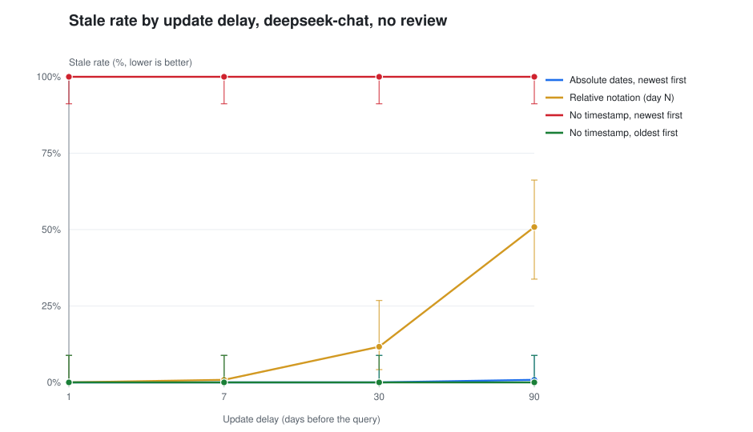
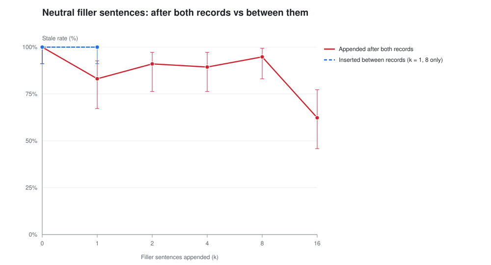
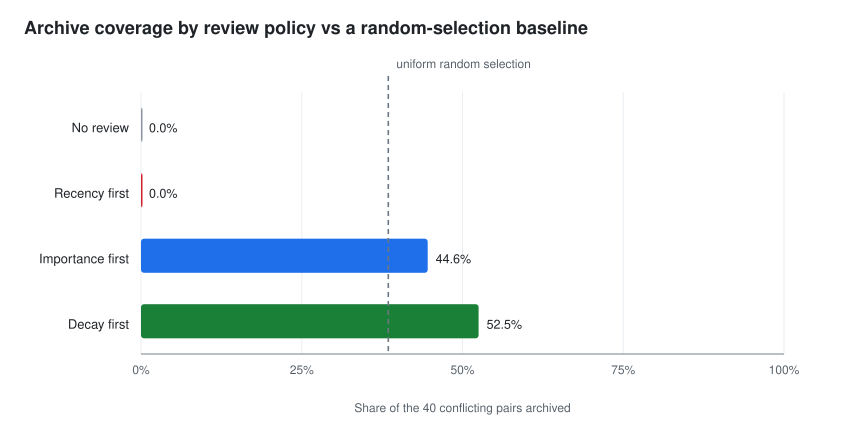

# Decidability Before Maintenance

**A reproducibility artifact for a study of how LLM agents choose between conflicting memory records.**

An agent's long-term store usually keeps both the outdated and the updated value for a
slot, because deleting is lossy and storage is cheap. When the agent answers, it has to
decide which record is current. This artifact contains the measurement pipeline, the
raw condition files and the analysis for a study of that decision: 37 conditions,
50,832 queries, four model configurations from two providers.

The study's claim is that *whether* two records can be adjudicated matters more than how
the memory is maintained. This repository exists so that the claim can be checked rather
than believed — including the parts of it that do not survive checking.

---

## What this repository is, and what it is not

| | |
|---|---|
| **It is** a consistency proof | `python -m memdec verify` recomputes all 62 numbers in the manuscript from `data/` and prints a pass/fail table. All 62 pass. |
| **It is** a deterministic replay | `tests/test_replay.py` rebuilds every store from the manifest, re-applies each review policy, re-assembles each context, and reproduces the shipped review counts exactly and all **1,920 of 1,920** verdicts in the core grid. |
| **It is not** a replication | Nothing here calls a model. Reproducing the *data* needs an API key and the commands in [`docs/REPRODUCING.md`](docs/REPRODUCING.md). No key is stored in this repository. |
| **It is not** a clean bill of health | The audit finds three blockers. They are in [`docs/REVIEW.md`](docs/REVIEW.md), and `python -m memdec audit` regenerates the evidence for each one. |

The distinction in the middle two rows is the whole point. A consistency check that
passes only tells you the manuscript matches its own data. The replay is stronger: it
shows the data is a deterministic function of the design, which is a problem for the
paper rather than a solution.

---

## Headline numbers

| Quantity | Value | Where it comes from |
|---|---|---|
| Conditions / queries | 37 / 50,832 | `data/runs.csv` |
| Published values reproduced | **62 / 62** | `python -m memdec verify` |
| Core-grid verdicts predicted from the design | **1,920 / 1,920** | `tests/test_replay.py` |
| Independent sampling units per condition | **40 chains** (not 480 queries) | `analysis_out/AUDIT.md` §3 |
| Cells where `stale = 1 − coverage` holds exactly | **every four-policy cell** | `analysis_out/AUDIT.md` §4 |
| Conflict-hit rate: recency / random / importance / decay | **0.0 / 38.5 / 43.5 / 50.6 %** | `analysis_out/tables/table4_archive.md` |

Two of those rows are the study and two are the problem. The position rule is real,
extreme and reproducible. But because the rule is deterministic, the outcome is fixed by
*which records remain in the context* — so the maintenance experiment measures archive
coverage, not model behaviour.

---

## Quickstart

No dependencies, no network, no API key. Python 3.10 or newer.

```bash
git clone https://github.com/tatusi285/memory-decidability.git
cd memory-decidability

python -m memdec verify     # 62/62 published values reproduce from data/
python -m unittest discover -s tests -t . -v    # 109 tests
python -m memdec build      # tables, figures, audit, claims -> analysis_out/
```

On Windows without `make`, `.\tasks.ps1 build` does the same thing.

To exercise the measurement pipeline without spending anything:

```bash
python -m memdec run --offline --chains 12 --seeds 1 --delays 1 --out out/smoke
```

`--offline` substitutes a deterministic rule simulator for the model. It is a plumbing
test, it records `"simulated": true` in `run_meta.json`, and its numbers must never be
reported.

---

## What the audit found

`python -m memdec audit` writes [`analysis_out/AUDIT.md`](docs/REVIEW.md) with the
evidence for each finding. The short version:

**Three blockers** — the paper's central quantity is an identity, not a result
(`stale = 1 − archive coverage` holds to machine precision, because archiving removes the
only competing record); the recency baseline cannot reach a conflict in this store, so
its 0% is structural; and importance is assigned uniformly at random, so "importance-first"
is a random prior and the two ranking policies are not independent manipulations.

**Seven major issues** — retrieval returns only the queried slot's records, so the 24
distractors never enter a context and the task is a two-record ordering judgement rather
than retrieval under a budget; the 480 queries are 40 chains measured twelve times, so
every interval is about 3.5× too narrow; a single hard-coded `t = 2.776` was used for
every sample size; the claim that timestamps eliminate staleness is contradicted by a
shipped cell at **21.0%**; the shuffled-order row is not comparable to the rows it is
compared with; the filler curve is non-monotone; and the end-to-end table cannot separate
the proposed layer from a one-line baseline.

**Five minor issues and one good news item** — an additivity sentence that does not add
up, a real-log corpus that is one sentence form with synthetic dates, documentation that
does not match the artifact, byte-identical files across providers, a negligible `unknown`
bucket, and one claim the paper *understates*: the position rule predicts 1,920 probes,
not 480.

Each finding in [`docs/REVIEW.md`](docs/REVIEW.md) carries evidence, impact and a specific
fix. [`docs/ROADMAP.md`](docs/ROADMAP.md) turns the fixes into a sequenced plan with the
experiments to run, their cost, and the wording to use in the revision.

中文读者：[`docs/zh/方法指导方案.md`](docs/zh/方法指导方案.md) 是同一份分析的完整中文版，
包含改写后的论文骨架与最小可行修改清单。

---

## Figures

The three figures regenerate from `data/` with `python -m memdec figures`, as plain SVG
with no plotting library.

**The position rule is total.** With no timestamps, order alone decides:



**The "strength curve" is not a curve.** One filler sentence costs 17 points, eight cost
5, sixteen cost 38:



**Against a random baseline, decay is modestly good and recency is hopeless.** This is the
comparison the paper's Table 4 does not make:



---

## Repository layout

```
memdec/                 measurement pipeline and analysis, standard library only
  prompts.py            the single source of truth for what the model was shown
  store.py              synthetic and real-log corpora
  policies.py           the four review policies
  scoring.py            answer classification, including its leniency
  runner.py             the measurement loop
  claims.py             the 62 published values, plus the disputed ones
  analysis/tables.py    every table, regenerated
  analysis/figures.py   every figure, as SVG
  analysis/audit.py     the diagnostics the paper's tables omit
data/
  runs.csv              normalised manifest: 37 runs, 50,832 probes
  runs/out_*/           one results.csv per condition (37 directories)
  daml/                 the end-to-end pilot
  corpus/               the 13 real-log chains
  source/               the author's original Chinese manifest and summary
  CHECKSUMS.sha256      every shipped CSV, hashed
docs/                   review, roadmap, protocol, reproduction, data dictionary
paper/                  the three manuscript builds (zh, IEEE two-column, single-column)
tests/                  109 tests, including the replay
analysis_out/           generated; not committed
```

---

## Reproducing a measurement

```bash
export MEMDEC_API_KEY="..."   # or DEEPSEEK_API_KEY / OPENAI_API_KEY

# The core condition: no timestamps, updated record first, uniform templates
python -m memdec run --time-format none --ctx-order newest_first \
    --chains 40 --seeds 3 --delays 1,7,30,90 --out out/recheck_bare

# The condition that contradicts the abstract: dates + mixed natural wording
python -m memdec run --time-format date --text-style natural \
    --chains 40 --seeds 3 --delays 1,7,30,90 --out out/recheck_date_natural
```

`results.csv` keeps the original 14-column schema, and `run_meta.json` records the prompt
version, the exact configuration, wall-clock time and whether the run was simulated.
Expect ±1–3 points of drift when re-running: `temperature = 0` is not bit-reproducible on
the provider side.

The full grid is about 4 hours and roughly 20 CNY of API spend at 6-way concurrency. The
per-condition diagnostics that decide most of the science cost **under 2 CNY** and do not
need another language model; see `docs/ROADMAP.md` stage 1.

---

## Data provenance and ethics

- The synthetic store is generated from a seed; it contains no personal data.
- The real-log corpus is 13 chains extracted from the author's own agent session logs,
  covering a single attribute (a local port) of one desktop application. No third-party
  data is involved. The extracted records are reproduced verbatim in
  `data/corpus/real_chains.json`, and the paper states the same.
- No API key, endpoint credential or session transcript is stored in this repository.
  `tests/test_data_integrity.py` fails if a key-shaped string or an absolute local path
  ever appears under `data/`.

---

## Citing

If you use this artifact, cite the paper and the repository — see [`CITATION.cff`](CITATION.cff).

```bibtex
@misc{li2026decidability,
  title  = {Decidability Before Maintenance: What Actually Determines Whether an
            LLM Agent Uses the Right Memory},
  author = {Li, Han},
  year   = {2026},
  note   = {Artifact: https://github.com/tatusi285/memory-decidability},
  url    = {https://github.com/tatusi285/memory-decidability}
}
```

## License

MIT — see [`LICENSE`](LICENSE). The manuscript PDFs in `paper/` are the author's work
and are covered by the same license.
