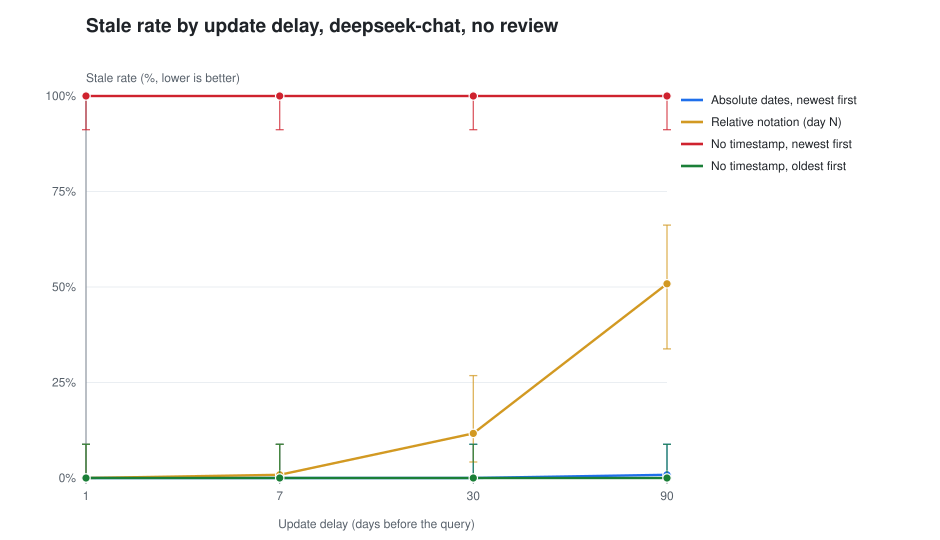
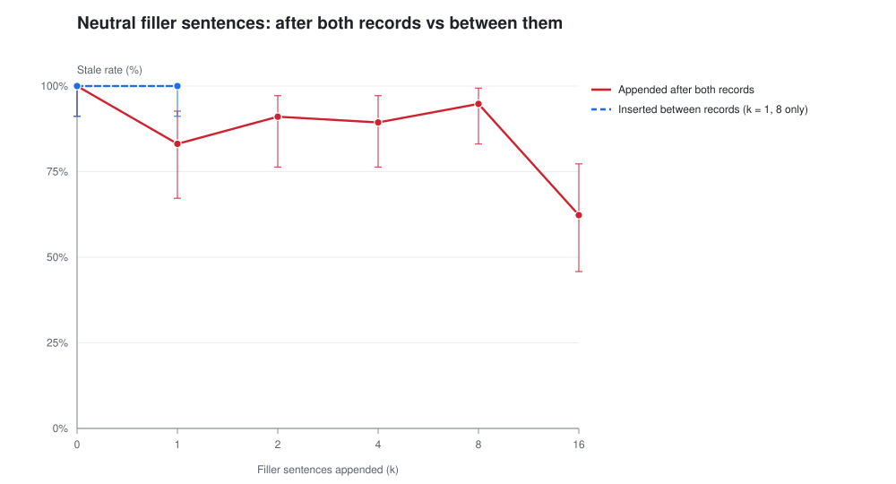
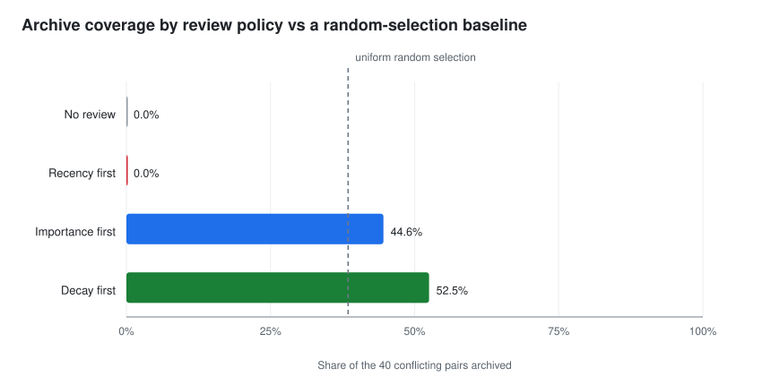

# 可判定性先于维护（中文说明）

本仓库是论文《Decidability Before Maintenance: What Actually Determines Whether an LLM
Agent Uses the Right Memory》的数据、测量代码与分析代码。

它做三件事，重要性递减：

1. **核对**：`python -m memdec verify` 把论文里的 62 个数字全部从 `data/` 重算一遍，逐项
   打印「论文值 / 重算值 / 是否一致」。62/62 一致。
2. **重放**：`tests/test_replay.py` 只凭 manifest 重建每一个记忆库、重放四种复习策略、重新
   组装上下文，精确复现 37 个运行目录里的复习与归档计数，并复现核心网格
   **1920/1920** 条判定。
3. **审计**：`python -m memdec audit` 生成 `docs/AUDIT.md`，给出论文表格里没有的诊断——
   精确区间、有效样本量、归档覆盖率恒等式、以及「冲突命中率 vs 随机基线」。

**它不能做的事**：它没有调用任何模型。重放证明的是「数据由设计决定」，而不是
「数据由模型行为决定」。要真正复跑，需要 API Key，命令见
[`REPRODUCING.md`](docs/REPRODUCING.md)。

---

## 三分钟上手

不需要任何第三方依赖，不需要联网。

```bash
python -m memdec verify
python -m unittest discover -s tests -t . -v
python -m memdec build
```

Windows 下也可以用 `.\tasks.ps1 build`。

不花钱试跑整条流水线（用确定性规则模拟器代替模型，结果**不可引用**）：

```bash
python -m memdec run --offline --chains 12 --seeds 1 --delays 1 --out out/smoke
```

**完整的中文分析与提升方案**：[`docs/zh/方法指导方案.md`](docs/zh/方法指导方案.md)
——包括三个结构性问题、重构后的论文骨架、五个对照实验和「只有一天时该改什么」。

---

## 关键数字

| 项目 | 数值 | 出处 |
|---|---|---|
| 条件数 / 查询数 | 37 / 50,832 | `data/runs.csv` |
| 论文数字复算一致 | **62 / 62** | `verify` |
| 核心网格可被设计完全预测的判定 | **1920 / 1920** | `tests/test_replay.py` |
| 每个条件的独立抽样单位 | **40 条链**（不是 480 次查询） | `AUDIT.md` §3 |
| `过期率 = 1 − 覆盖率` 精确成立的运行 | 29 个四策略运行中的 4 个 | `AUDIT.md` §4 |
| 冲突命中率：最近 / 随机 / 重要度 / 衰减 | **0.0 / 38.5 / 43.5 / 50.6 %** | `docs/tables/table4_archive.md` |

前两行是这篇论文；后三行是它的问题。位置规则是真的、极强的、可复现的；但正因为它是
确定性的，结果就由「上下文里还剩哪些记录」唯一决定——于是维护策略实验测的是归档覆盖率，
不是模型行为。

---

## 审计发现了什么

完整版在 [`docs/REVIEW.md`](docs/REVIEW.md)，证据在 [`docs/AUDIT.md`](docs/AUDIT.md)。
摘要：

**三个阻断级问题**

- 论文的核心量其实是恒等式：在论文报告它的那个条件下，`过期率 = 1 − 覆盖率` 在全部 48 个
  batch 单元里精确到 `5.5e-17`。原因很直白——归档把唯一的竞争记录删掉了，只剩一条记录时
  答案必然正确，两条记录时位置规则必然选错。论文在 4.4 节写出了这个机制，紧接着又把它当作
  实证规律报告了一次，摘要里再报告一次。
- 「最近优先」在这个记忆库里根本够不到冲突：40 条更新记录写在第 199 天（最晚），几乎占满
  41 条的复习预算。它的 0% 是结构性上限，不是对「最近优先」这个信号的测量。
- 重要度是**随机分配**的：`build_store` 从 `{0.9, 0.7, 0.55, 0.35}` 里均匀抽，与「哪条是
  当前值」无关。所以「重要度优先」只是一个随机先验；而衰减半衰期由重要度分档决定，两种策略
  并不独立——论文却拿它们互相作证。

**七个重要问题**

- 检索按实体过滤，24 条干扰记录从不进入被询问的上下文。上下文永远只有 1–2 条记录，所以
  「检索预算」的说法在测量里不成立，预算只约束复习。
- 480 次查询其实是 40 条链各测 12 次，链内判定几乎恒定。按 480 个独立样本算区间，窄了约
  3.5 倍；40/40 单元格的诚实区间是 [91.2, 100.0]，不是「100.0 ± 0.0」。
- 置信区间一直用硬编码的 `t = 2.776`（只对 `df = 4` 正确）：按种子的表（n=3）窄了约 1.6 倍，
  合并表（n=12）反而宽了约 1.3 倍。
- 「有时间戳就没有过期误用」被仓库里一个单元格直接否证：混合自然表述 + 绝对日期 = **21.0%**，
  90 天档升到 **29.2%**。这个条件在 `data/runs/out_nat_date_new` 里，论文没写，作者的 62 项
  自检里也没有。
- 打乱顺序那一行（34.8%）用的是混合表述，而混合表述自己的基线是 65%，不能拿它和 0/100 比较。
- 填充句曲线不是单调衰减：100 → 83.1 → 91.0 → 89.4 → 94.8 → 62.3，k=1..8 的趋势显著为正
  （Cochran–Armitage z = +4.99）。「连续强度」「过了阈值才崩」都不描述这条曲线。
- 端到端表无法区分所提方法与一行基线：`timestamped` 和 `daml` 都是 40/40。

**五个次要问题 + 一条对论文有利的发现**：加法律错了、真实日志语料其实只有一种句式且日期是
合成的、文档与仓库不符、跨厂商出现字节相同的文件、`unknown` 占比 0.26% 使「为何用过期率
而非准确率」的论证失去依据；而位置规则其实比论文说的更强——能预测 1920 条，不是 480 条。

---

## 目录结构

```
memdec/                 测量流水线与分析（仅标准库）
  prompts.py            模型看到的每一个字的唯一来源
  store.py              合成语料与真实日志语料
  policies.py           四种复习策略（外加 random 基线）
  scoring.py            判定规则，包括它的宽松之处
  runner.py             测量主循环
  claims.py             62 个论文数字，以及被争议的那些
  analysis/tables.py    全部表格
  analysis/figures.py   全部图（SVG，无绘图库）
  analysis/audit.py     论文表格里没有的诊断
data/                   37 个条件目录、端到端结果、真实语料、校验和
docs/                   REVIEW / ROADMAP / PROTOCOL / REPRODUCING / 数据字典 / 局限
docs/tables|figures/    自动生成，已提交
paper/                  三个 PDF 版本
tests/                  125 个测试
```

---

## 引用的三个图







---

## 数据来源与伦理

- 合成语料由种子生成，不含任何个人信息。
- 真实日志语料是作者自己智能体会话里 13 条链、单一属性（本地端口）的记录，不涉及第三方数据；
  原文逐字保存在 `data/corpus/real_chains.json`。
- 仓库内不含任何 API Key、端点凭据或会话原文。`tests/test_data_integrity.py` 会在 `data/`
  下出现疑似密钥或绝对路径时报错。

## 许可

MIT，见 [`LICENSE`](LICENSE)。
